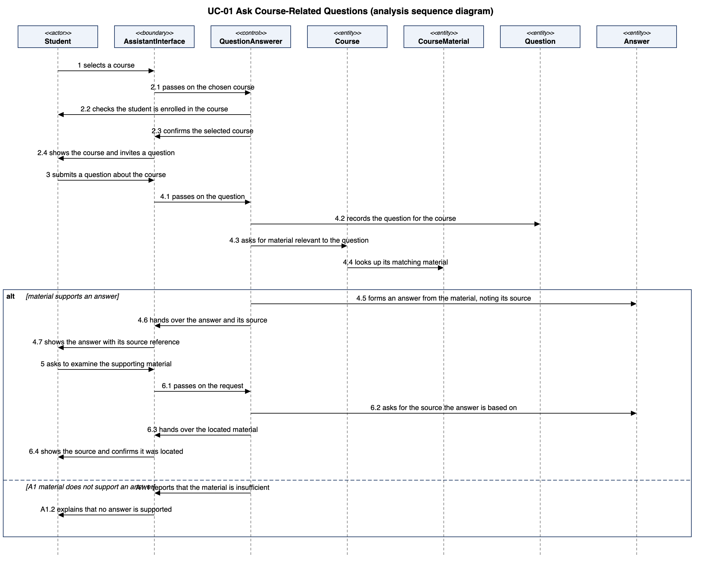

### 5.2.1 UC-01 Ask Course-Related Questions

**(a) Non-trivial steps.**

| Step (from 4.2) | Non-trivial? | Why |
|---|---|---|
| (0) The system presents the student's available courses | No | The same enrollment lookup appears as message 2.2 |
| (1) The student selects a course | No | The student's input; the interface only receives it |
| (2) The system confirms the course and invites a question | Yes | Needs a check that the student is enrolled in the chosen course (A3 when not) |
| (3) The student submits a question | No | The student's input; the interface only receives it |
| (4) The system presents an answer supported by course information, with its source | Yes | Needs the course's material, an answer formed only from it, and the source it came from (A1 when the material is insufficient) |
| (5) The student asks to examine the supporting material | No | The student's input; the interface only receives it |
| (6) The system identifies the source and confirms it was located | Yes | Needs the source recorded with the answer |

Two interaction objects take part besides the domain classes from 5.1 (Student, Course, CourseMaterial, Question, Answer): **AssistantInterface** (boundary, the same one as in 5.2.2) takes the student's requests and shows responses; **QuestionAnswerer** (control) checks access, gathers course material and forms the answer. It is in control of this interaction.

**(b) Scenario table.**

| Step | Subject (who acts) | Subject action (what it does) | Other data / objects (what is used) | Object acted upon (who receives) |
|---|---|---|---|---|
| 1 | Student | selects a course | the chosen course | AssistantInterface |
| 2.1 | AssistantInterface | passes on the chosen course | Course | QuestionAnswerer |
| 2.2 | QuestionAnswerer | checks the student is enrolled in the course | Course | Student |
| 2.3 | QuestionAnswerer | confirms the selected course | Course | AssistantInterface |
| 2.4 | AssistantInterface | shows the course and invites a question | Course | Student |
| 3 | Student | submits a question about the course | question text | AssistantInterface |
| 4.1 | AssistantInterface | passes on the question | question text, Course | QuestionAnswerer |
| 4.2 | QuestionAnswerer | records the question for the course | question text, Course | Question |
| 4.3 | QuestionAnswerer | asks for material relevant to the question | Question | Course |
| 4.4 | Course | looks up its matching material | Question | CourseMaterial |
| 4.5 | QuestionAnswerer | forms an answer from the material, noting its source | CourseMaterial | Answer |
| 4.6 | QuestionAnswerer | hands over the answer and its source | Answer | AssistantInterface |
| 4.7 | AssistantInterface | shows the answer with its source reference | Answer | Student |
| 5 | Student | asks to examine the supporting material | Answer | AssistantInterface |
| 6.1 | AssistantInterface | passes on the request | Answer | QuestionAnswerer |
| 6.2 | QuestionAnswerer | asks for the source the answer is based on | | Answer |
| 6.3 | QuestionAnswerer | hands over the located material | CourseMaterial | AssistantInterface |
| 6.4 | AssistantInterface | shows the source and confirms it was located | CourseMaterial | Student |
| A1.1 | QuestionAnswerer | reports that the material is insufficient | Question | AssistantInterface |
| A1.2 | AssistantInterface | explains that no answer is supported | | Student |

**(c) Analysis sequence diagram.**

*Figure 5.2.1 Analysis sequence diagram for UC-01; message numbers match the scenario table. Source: `docs/p2/diagrams/uc01-analysis-sequence.puml`.*
